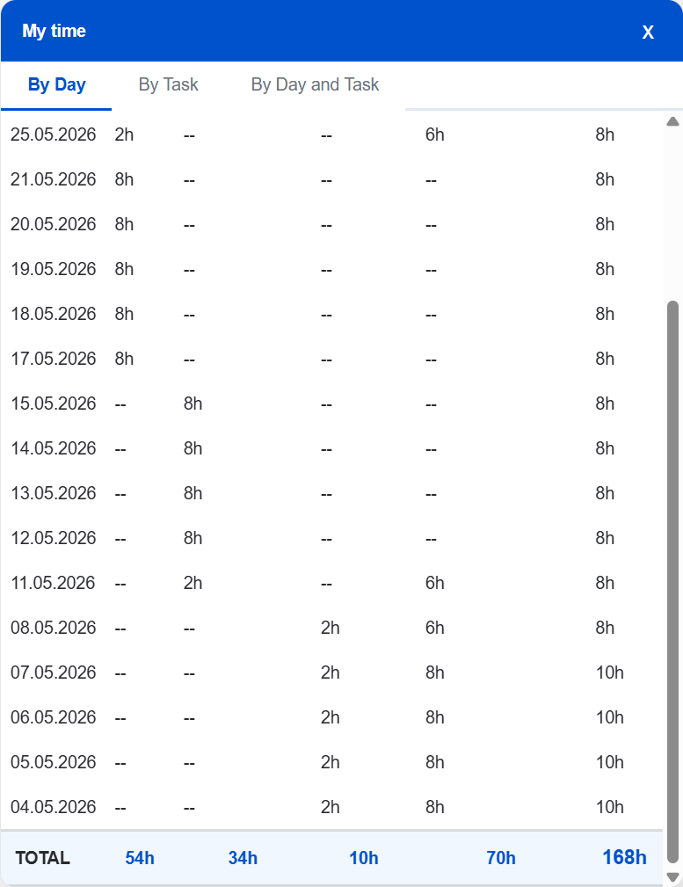
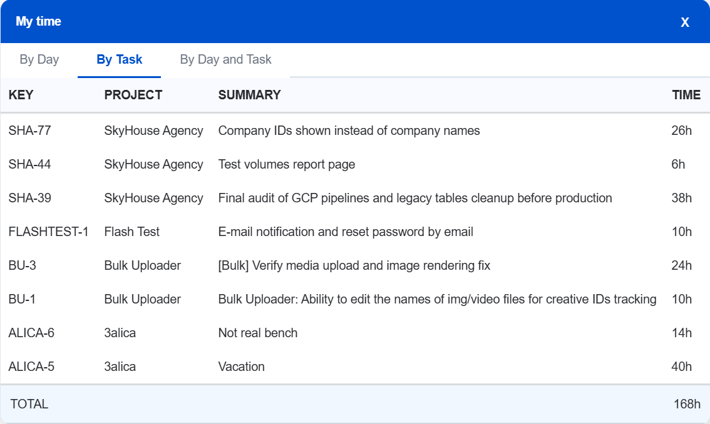
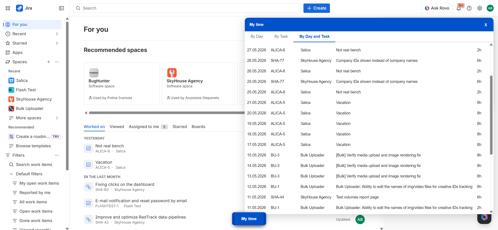

# Jira Worktime Viewer

A browser bookmarklet that shows your logged work time directly on any Jira page.

📺 [Video: How to install (russian)](https://youtu.be/WgnBNNXFlwI)

## What it does

Opens a floating panel with three tabs over the current Jira page. All data is fetched once from the Jira REST API.

Projects, tasks, and worklog rows with zero logged time are left out. A project column appears only when that project has hours in the current view. A `--` cell means no time on that day, while the project still has time on another day.

**From / To**, under the tabs, limits every tab to a date range. Leave a field empty to keep that side open. The boundary day is included. **Reset** clears both fields and shows the full log again. Task totals count only hours inside the range.

The screenshots below show the three tabs. The date fields sit above the table and are not in these images.

**By Day** — daily matrix: rows = dates, columns = projects, with totals:

**By Task** — total hours logged per ticket:

**By Day and Task** — flat log of every worklog entry (DATE / KEY / PROJECT / SUMMARY / TIME):

---

## Installation

> **Why not just add a bookmark directly?**
> Browsers limit bookmark URLs to ~2000 characters. The bookmarklet code is longer than that, so pasting it directly into a bookmark URL field will silently truncate it and break the script. The workaround below avoids this limitation.

### Steps

**1. Open Jira** in Chrome or any Chromium-based browser and make sure the bookmarks bar is visible (`Ctrl+Shift+B`).

**2. Open DevTools console** — press `F12`, then click the **Console** tab.

**3. Paste the installer script** — open `bookmarklet-by-day-and-task.js` from this repo, copy the entire contents, paste into the console, and press `Enter`.

> **If pasting is blocked:** Chrome may show a self-XSS warning and ignore the paste. Type `allow pasting` directly into the console and press `Enter` — then paste the script again. This is a one-time action per Chrome profile.

A blue **My time** button will appear at the bottom center of the page.

**4. Drag the button to your bookmarks bar** — click and hold the blue button, then drag it up to the bookmarks bar and release.

The bookmark is now saved with the full script intact.

**5. Done.** Click the bookmark on any Jira page to open the panel.

To pick up a new version, run the installer again and drag the new **My time** button onto the old bookmark. The saved bookmark keeps the script from the moment you dragged it.

---

## Usage

1. Navigate to any page on your Jira instance (must be logged in).
2. Click the **My time** bookmark.
3. The panel loads and displays your worklogs. Switch between tabs as needed.
4. Set **From** and **To** to limit the tables. Click **Reset** to show every date again.
5. Click **×** in the panel header to close it.

---

## How it works

The bookmarklet calls Jira REST API endpoints using your existing browser session (no credentials required):

- `GET /rest/api/3/myself` — resolves your account ID
- `GET /rest/api/3/search/jql?jql=worklogAuthor=currentUser()` — fetches every issue with your worklogs, page by page (`nextPageToken`, 100 issues per page)
- `GET /rest/api/3/issue/{key}/worklog` — loads the rest of an issue's worklogs when search returns only the first 20, and keeps requesting pages of 100 until a short page comes back

All requests use the same authentication cookie that Jira already has in your browser. Nothing is sent anywhere else.

---

## Files

| File | Description |
|---|---|
| `bookmarklet-by-day-and-task.js` | Installer script — paste into browser console to create the draggable bookmark button |
| `img/` | Screenshots used in this README |
